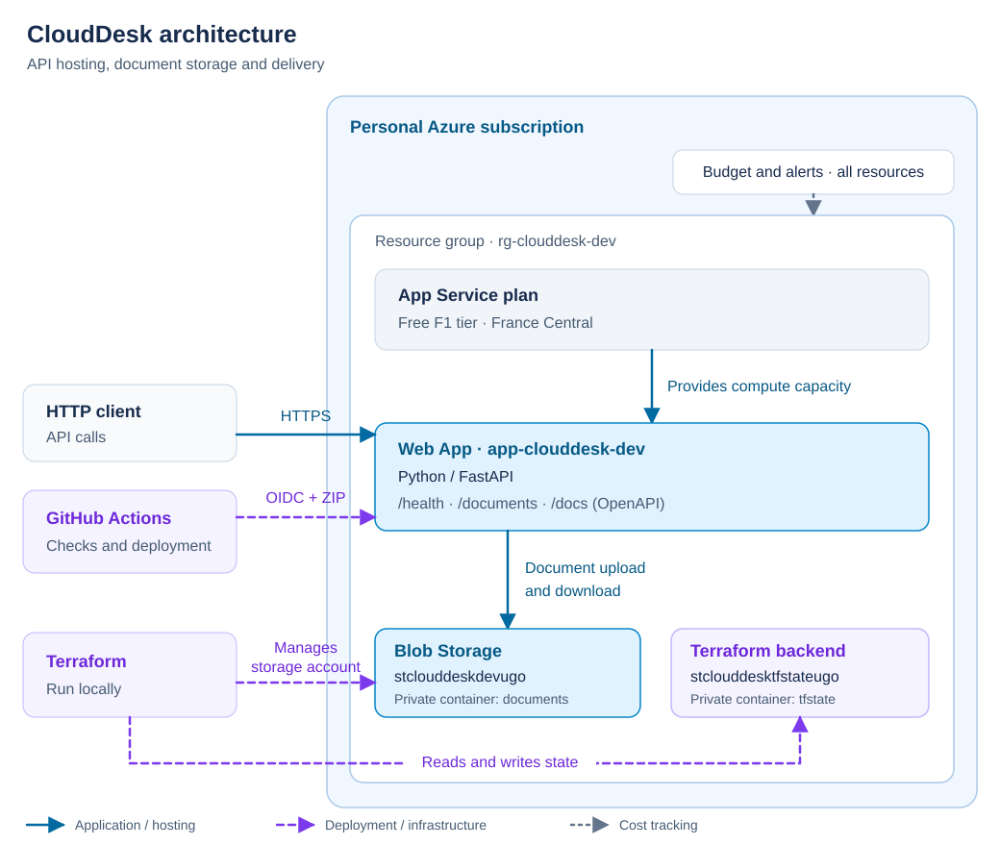

# CloudDesk

Personal project to prepare for the **AZ-900**, then **AZ-104** certifications: gradually build an API for tracking IT requests and understand the choices required to host it in Azure.

## Project status

**First deployment validated on October 18, 2026**: the `GET /health` route responds from Azure App Service.

**Monitoring practiced on October 19, 2026**: observing requests and 404 responses, saving a private dashboard, reading logs, configuring warm-up on `/health`, and reviewing the administration history. This documentation covers the observations confirmed during these sessions.

The application now implements IT request creation and document upload/download through Azure Blob Storage, alongside the health endpoint and interactive OpenAPI documentation. GitHub Actions runs Python, Terraform, and security checks, then deploys to App Service on updates to `main` when all three check jobs succeed. The application storage account is managed with Terraform, whose state is stored in a separate Azure Blob Storage account.

The first functional step is limited to creating an IT request with a title, description, and priority. The API generates its ID, initial `open` status, and UTC timestamps, then saves it as JSON in a separate private `requests` container. This route requires a shared API key; there are no user accounts or web interface yet. Listing, reading, and processing requests are future steps. Documents are currently independent files, without a link to a request.

The document and request tests use mocked Azure clients. They check API behavior without contacting Azure; they do not establish that the deployed application has working storage access. The new request container, runtime permissions, and API key must be configured before using request creation in Azure.

| Item | Selected configuration |
| --- | --- |
| API | Python, FastAPI, and Uvicorn |
| Python project management | uv, `pyproject.toml`, and `uv.lock` |
| Local execution | WSL/Ubuntu |
| Resource group | `rg-clouddesk-dev` |
| Web application | `app-clouddesk-dev` |
| App Service plan specified at creation | `asp-clouddesk-dev-frc`, Free F1 tier |
| Hosting region | France Central (`francecentral`) |
| Deployment | GitHub Actions, OIDC authentication, and ZIP upload with Azure CLI |
| Application storage | `stclouddeskdevugo`, private `documents` container, Microsoft Entra ID credentials |
| IT request storage | One JSON blob per request in a separate private `requests` container, to provision before use |
| Infrastructure as code | Terraform for the application storage account |
| Terraform state | `stclouddesktfstateugo`, private `tfstate` container |
| Automated checks | Ruff, pytest, Terraform formatting and validation, and security scans |
| Dependency updates | Dependabot for GitHub Actions, Python dependencies, and Terraform providers |
| Cost tracking | Subscription-level budget, without a resource group filter |
| Monitoring view | Private dashboard `CloudDesk - Dev`, `Requests` and `Http 404` metrics |
| Logs | App Service File System and Log stream |
| Startup check | `/health`, with expected status `200` |

The Python version and tool versions were not recorded during the first session. The commands for checking them are in the [deployment guide](docs/deploiement.md).

## Architecture

[](docs/assets/architecture.svg)

The resource group organizes the components. The plan defines the hosting capacity and pricing tier. The Web App holds the application's configuration and its domain. A subscription-wide budget also tracks spending on any resources created outside this group.

## Local execution

Prerequisites: [uv](https://docs.astral.sh/uv/getting-started/installation/) and a Python version compatible with `requires-python` in `pyproject.toml`.

From the project root:

```bash
uv sync --locked
uv run uvicorn main:app --reload
```

Open:

- API health check: <http://localhost:8000/health>
- Interactive documentation: <http://localhost:8000/docs>

Expected response from `/health`:

```json
{"status":"ok","application":"clouddesk"}
```

The check confirms that the application's route responds. It does not measure availability over time or check any external dependencies.

### Using document storage locally

The document routes require the existing private `documents` container, an Azure identity with blob data permissions on it, and the storage account URL. For local development with Azure CLI credentials:

```bash
az login
export AZURE_STORAGE_ACCOUNT_URL="https://stclouddeskdevugo.blob.core.windows.net"
uv run uvicorn main:app --reload
```

The application uses `DefaultAzureCredential`. In App Service, configure the same environment variable and a managed identity with the required blob data permissions. The GitHub deployment identity and the application's runtime identity serve separate purposes; deployment access does not grant document access.

Without the storage URL, `/health` and `/docs` remain available, while the document routes return `503`. The [storage guide](docs/storage.md) records the initial portal exercise and the developer's data access; it predates the application's document routes.

### Creating an IT request

See the [request creation guide](docs/requests.md) to provision the private `requests` container, configure `CLOUDDESK_API_KEY`, and call `POST /requests`. This feature reuses the existing Azure SDK and storage account. It does not use a local database or save requests on the App Service filesystem.

## Current API

| Method | Route | Behavior |
| --- | --- | --- |
| `GET` | `/health` | Returns the application health response, without checking storage. |
| `POST` | `/requests` | Requires a bearer API key; validates and saves an IT request, then returns the complete record with `201`. |
| `POST` | `/documents` | Accepts a multipart `file`, stores it under `uploads/{id}`, and returns `201` with its UUID, original filename, and size in bytes. |
| `GET` | `/documents/{document_id}` | Downloads a document by UUID as `application/octet-stream`, with the filename `{id}.bin`. |
| `GET` | `/docs` | Opens the interactive API documentation. |

Uploads must be non-empty and at most **5 MiB**. Empty files return `400`; oversized files return `413`. Downloads also enforce the size limit. Invalid document UUIDs return `422`, missing documents return `404`, and missing storage configuration or Azure SDK errors return `503`.

The original filename is returned at upload time but is not persisted as application metadata. The document routes currently have no user authentication or per-document access rules; the private storage container protects direct blob access, while the API uses its own Azure credentials. The API key protects only the new request creation route.

## Development checks and deployment

Run the Python checks locally:

```bash
uv run --locked ruff check .
uv run --locked python -m pytest
```

Tests cover `/health`, document upload/download, and request creation. Request tests check the saved JSON, generated fields, validation, API key checks, and storage failures. Azure credentials and storage clients are replaced with mocks.

The [GitHub Actions workflow](.github/workflows/ci.yml) runs Python checks, Terraform formatting and validation, and security checks on pull requests targeting `main` and pushes to `main`. Checks can also run manually and on a weekly schedule. Deployment runs only on pushes to `main` after all three check jobs pass, then calls `/health` remotely. Terraform planning and application remain local operations.

The security job audits Python dependencies with pip-audit, analyzes Python code with Bandit, and uses Checkov for secret scanning and a selected Terraform storage security baseline. Dependabot proposes dependency updates. The [SecOps guide](docs/secops.md) describes the checks and their scope.

The deployment archive includes `main.py`, the `clouddesk/` application modules, `pyproject.toml`, `uv.lock`, and `README.md`. Adding other application modules or assets requires updating that file list.

## Next application milestone

Request creation is implemented. The next steps toward a usable IT request workflow are:

1. Validate real Azure persistence with the configured private `requests` container and runtime identity.
2. Add routes to list and read requests.
3. Add status changes from open to in progress to resolved, with appropriate persistence and tests.

The current acceptance scenario is to create a request and verify its JSON in Blob Storage. Each request is written independently without overwriting an existing blob. Blob storage is sufficient for this creation-only step; queries, pagination, and concurrent status changes will require a separate design decision. Linking existing documents to requests, adding users and access rules, and building a web interface will follow.

## Technical choices and rationale

| Choice | Why this choice for this milestone? | Limitation or consequence |
| --- | --- | --- |
| FastAPI | Quickly provide a Python API and focus learning on Azure. | The business features still need to be built. |
| uv | Manage dependencies and keep their resolved versions in `uv.lock`. | The lockfile must be versioned and delivered with the code. |
| Python application at the root | Start the `app` object from `main.py` directly. | Set `package = false` to avoid a package build expecting files under `src/`. |
| App Service, PaaS model | Delegate server and system management to Azure. | Code, dependencies, data, and access remain our responsibility. |
| F1 tier | Start with free hosting capacity for learning. | Quotas, limited capacity, and no SLA; a tier intended for testing. |
| France Central | Use a region allowed by this student subscription. | This permission is specific to the subscription and must be checked again when reproducing the setup. |
| Dedicated development group | Make CloudDesk's lifecycle easier to manage. | Deleting the group deletes the resources it contains. |
| GitHub Actions and ZIP deployment | Check changes before automatically deploying updates to `main`, using OIDC for Azure authentication. | The archive uses an explicit file list; the remote health check does not verify storage access. |
| Azure Blob Storage | Store uploaded document content separately from application code. | Request associations and persistent document metadata still need to be built. |
| JSON blobs for IT request creation | Reuse existing storage and dependencies, with one independent write per request. | Requires a separate private container and runtime access; future querying may justify a database. |
| Shared bearer API key for request creation | Protect the new write route while keeping this first feature small. | A shared secret does not provide user identity or per-user permissions; document routes are still unprotected. |
| Terraform with remote state | Version the application storage account configuration and keep state in a dedicated Azure backend. | App Service, identities, RBAC assignments, and backend bootstrap are outside the current Terraform configuration. |
| Subscription-level budget | Track spending across the entire lab. | Alerts do not stop resources or consumption. |
| Private dashboard | Retrieve monitoring charts without rebuilding their configuration. | Created in the portal and associated with the account; its JSON export is not yet versioned. |
| Warm-up on `/health` | Wait for a 200 response from the API before considering the container ready. | The check covers startup; the current route checks the API's response. |

The F1 plan's free pricing applies to that plan; any service added to the project must be assessed separately.

## Responsibilities with PaaS

| Azure | Project owner |
| --- | --- |
| Physical infrastructure, servers, and platform operating system | Code, dependencies, and startup configuration |
| Operating the App Service platform | Access configuration and protection of application data |

This division connects the project to the AZ-900 concepts of PaaS and shared responsibility.

## Practical guides

- [Threat model](docs/threat-model.md): three main risks explained with simple examples and a visual diagram.
- [Deployment](docs/deploiement.md): resources, Python configuration, Azure CLI commands, and issues from the first deployment.
- [Monitoring and diagnostics](docs/supervision.md): Metrics, private dashboard, Log stream, warm-up, and Activity log, with the observed results.
- [CI/CD with GitHub Actions and Azure](docs/ci-cd.md)
- [SecOps: security checks and dependency updates](docs/secops.md)
- [Azure Blob Storage](docs/storage.md)
- [IT request creation](docs/requests.md): API contract, private container, API key, and manual validation.
- [Terraform: adopting the existing storage account](docs/terraform.md)
- [Terraform remote state](docs/terraform-remote-state.md)

The guides record earlier milestones and their validation boundaries. Azure portal labels are shown in English.

## Official references

- [App Service](https://learn.microsoft.com/en-us/azure/app-service/overview)
- [App Service plans](https://learn.microsoft.com/en-us/azure/app-service/overview-hosting-plans)
- [App Service Linux pricing](https://azure.microsoft.com/en-us/pricing/details/app-service/linux/)
- [uv projects](https://docs.astral.sh/uv/guides/projects/)
- [uv packaging configuration](https://docs.astral.sh/uv/concepts/projects/config/)
- [Shared responsibility in the cloud](https://learn.microsoft.com/en-us/azure/security/fundamentals/shared-responsibility)
