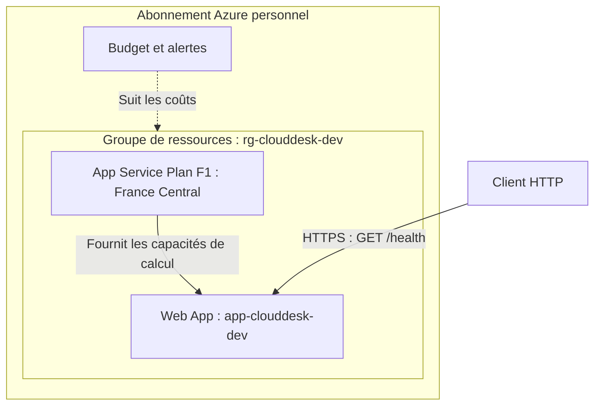

# CloudDesk

Projet personnel de préparation aux certifications **AZ-900**, puis **AZ-104** : construire progressivement une API de suivi de demandes IT et comprendre les choix nécessaires à son hébergement dans Azure.

## État du projet

**Premier déploiement validé le 18 octobre 2026** : la route `GET /health` répond depuis Azure App Service. Cette documentation décrit ce jalon ; elle ne constitue pas une nouvelle vérification de l'environnement Azure.

La création et le traitement des demandes IT sont les prochaines fonctionnalités prévues. À ce stade, l'application expose une route de contrôle et sa documentation OpenAPI.

| Élément | Configuration retenue |
| --- | --- |
| API | Python, FastAPI et Uvicorn |
| Gestion du projet Python | uv, `pyproject.toml` et `uv.lock` |
| Exécution locale | WSL/Ubuntu |
| Groupe de ressources | `rg-clouddesk-dev` |
| Application web | `app-clouddesk-dev` |
| Plan App Service prévu lors de la création | `asp-clouddesk-dev-frc`, niveau Free F1 |
| Région d'hébergement | France Central (`francecentral`) |
| Déploiement | Archive ZIP envoyée avec Azure CLI |
| Suivi des coûts | Budget au niveau de l'abonnement, sans filtre de groupe de ressources |

La version Python et les versions des outils n'ont pas été relevées lors de la première séance. Les commandes permettant de les consulter sont dans le [guide de déploiement](docs/deploiement.md).

## Architecture



Le groupe de ressources organise les composants. Le plan définit les capacités d'hébergement et le niveau tarifaire. La Web App porte la configuration de l'application et son domaine. Un budget à l'échelle de l'abonnement suit aussi les dépenses des ressources éventuellement créées en dehors de ce groupe.

## Exécution locale

Prérequis : [uv](https://docs.astral.sh/uv/getting-started/installation/) et une version Python compatible avec `requires-python` dans `pyproject.toml`.

Depuis la racine du projet :

```bash
uv sync --locked
uv run uvicorn main:app --reload
```

Ouvrir :

- Contrôle de l'API : <http://localhost:8000/health>
- Documentation interactive : <http://localhost:8000/docs>

Réponse attendue sur `/health` :

```json
{"status":"ok","application":"clouddesk"}
```

Le contrôle confirme que la route de l'application répond. Il ne mesure pas sa disponibilité dans le temps et ne vérifie aucune dépendance externe.

## Choix techniques et raisons

| Choix | Pourquoi ce choix pour ce jalon ? | Limite ou conséquence |
| --- | --- | --- |
| FastAPI | Fournir rapidement une API Python et concentrer l'apprentissage sur Azure. | Les fonctions métier restent à construire. |
| uv | Gérer les dépendances et conserver leurs versions résolues dans `uv.lock`. | Le lockfile doit être versionné et livré avec le code. |
| Application Python à la racine | Démarrer directement l'objet `app` de `main.py`. | Configuration `package = false` pour éviter une construction de paquet attendue sous `src/`. |
| App Service, modèle PaaS | Confier la gestion des serveurs et du système à Azure. | Le code, les dépendances, les données et les accès restent sous notre responsabilité. |
| Offre F1 | Commencer par une capacité d'hébergement gratuite pour l'apprentissage. | Quotas, capacités limitées et absence de SLA ; offre destinée aux essais. |
| France Central | Utiliser une région autorisée par cet abonnement étudiant. | Cette autorisation est propre à l'abonnement et doit être revérifiée lors d'une reproduction. |
| Groupe dédié au développement | Faciliter la gestion du cycle de vie de CloudDesk. | Une suppression du groupe supprime les ressources qu'il contient. |
| Déploiement ZIP manuel | Comprendre les étapes d'envoi, de préparation et de démarrage du code. | Les nouvelles versions nécessitent un nouveau déploiement manuel. |
| Budget au niveau de l'abonnement | Suivre les dépenses de tout le laboratoire. | Les alertes n'arrêtent pas les ressources ni la consommation. |

La gratuité du plan F1 concerne ce plan ; tout service ajouté au projet devra être évalué séparément.

## Responsabilités avec le PaaS

| Azure | Responsable du projet |
| --- | --- |
| Infrastructure physique, serveurs et système de la plateforme | Code, dépendances et configuration de démarrage |
| Exploitation de la plateforme App Service | Configuration des accès et protection des données de l'application |

Cette répartition permet de relier le projet aux notions AZ-900 de PaaS et de responsabilité partagée.

## Déployer et diagnostiquer

Le [guide de déploiement](docs/deploiement.md) contient les réglages Azure, les commandes, la validation HTTP et le compte rendu des incidents rencontrés.

## Références officielles

- [App Service](https://learn.microsoft.com/en-us/azure/app-service/overview)
- [Plans App Service](https://learn.microsoft.com/en-us/azure/app-service/overview-hosting-plans)
- [Tarification App Service Linux](https://azure.microsoft.com/en-us/pricing/details/app-service/linux/)
- [Projets uv](https://docs.astral.sh/uv/guides/projects/)
- [Configuration du packaging uv](https://docs.astral.sh/uv/concepts/projects/config/)
- [Responsabilité partagée dans le cloud](https://learn.microsoft.com/en-us/azure/security/fundamentals/shared-responsibility)
