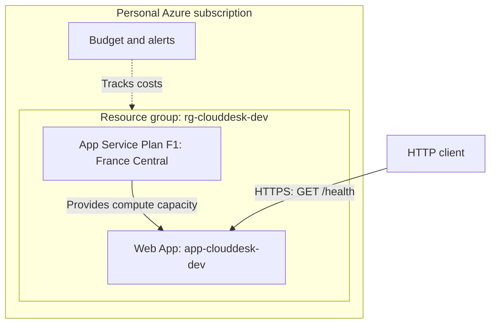

# CloudDesk

Personal project to prepare for the **AZ-900**, then **AZ-104** certifications: gradually build an API for tracking IT requests and understand the choices required to host it in Azure.

## Project status

**First deployment validated on October 18, 2026**: the `GET /health` route responds from Azure App Service.

**Monitoring practiced on October 19, 2026**: observing requests and 404 responses, saving a private dashboard, reading logs, configuring warm-up on `/health`, and reviewing the administration history. This documentation covers the observations confirmed during these sessions.

Creating and processing IT requests are the next planned features. At this stage, the application exposes a health endpoint and its OpenAPI documentation.

| Item | Selected configuration |
| --- | --- |
| API | Python, FastAPI, and Uvicorn |
| Python project management | uv, `pyproject.toml`, and `uv.lock` |
| Local execution | WSL/Ubuntu |
| Resource group | `rg-clouddesk-dev` |
| Web application | `app-clouddesk-dev` |
| App Service plan specified at creation | `asp-clouddesk-dev-frc`, Free F1 tier |
| Hosting region | France Central (`francecentral`) |
| Deployment | ZIP archive uploaded with Azure CLI |
| Cost tracking | Subscription-level budget, without a resource group filter |
| Monitoring view | Private dashboard `CloudDesk - Dev`, `Requests` and `Http 404` metrics |
| Logs | App Service File System and Log stream |
| Startup check | `/health`, with expected status `200` |

The Python version and tool versions were not recorded during the first session. The commands for checking them are in the [deployment guide](docs/deploiement.md).

## Architecture



The resource group organizes the components. The plan defines the hosting capacity and pricing tier. The Web App holds the application's configuration and its domain. A subscription-wide budget also tracks spending on any resources created outside this group.

## Local execution

Prerequisites: [uv](https://docs.astral.sh/uv/getting-started/installation/) and a Python version compatible with `requires-python` in `pyproject.toml`.

From the project root:

```bash
uv sync --locked
uv run uvicorn main:app --reload
```

Open:

- API health check: <http://localhost:8000/health>
- Interactive documentation: <http://localhost:8000/docs>

Expected response from `/health`:

```json
{"status":"ok","application":"clouddesk"}
```

The check confirms that the application's route responds. It does not measure availability over time or check any external dependencies.

## Technical choices and rationale

| Choice | Why this choice for this milestone? | Limitation or consequence |
| --- | --- | --- |
| FastAPI | Quickly provide a Python API and focus learning on Azure. | The business features still need to be built. |
| uv | Manage dependencies and keep their resolved versions in `uv.lock`. | The lockfile must be versioned and delivered with the code. |
| Python application at the root | Start the `app` object from `main.py` directly. | Set `package = false` to avoid a package build expecting files under `src/`. |
| App Service, PaaS model | Delegate server and system management to Azure. | Code, dependencies, data, and access remain our responsibility. |
| F1 tier | Start with free hosting capacity for learning. | Quotas, limited capacity, and no SLA; a tier intended for testing. |
| France Central | Use a region allowed by this student subscription. | This permission is specific to the subscription and must be checked again when reproducing the setup. |
| Dedicated development group | Make CloudDesk's lifecycle easier to manage. | Deleting the group deletes the resources it contains. |
| Manual ZIP deployment | Understand the steps for uploading, preparing, and starting the code. | New versions require another manual deployment. |
| Subscription-level budget | Track spending across the entire lab. | Alerts do not stop resources or consumption. |
| Private dashboard | Retrieve monitoring charts without rebuilding their configuration. | Created in the portal and associated with the account; its JSON export is not yet versioned. |
| Warm-up on `/health` | Wait for a 200 response from the API before considering the container ready. | The check covers startup; the current route checks the API's response. |

The F1 plan's free pricing applies to that plan; any service added to the project must be assessed separately.

## Responsibilities with PaaS

| Azure | Project owner |
| --- | --- |
| Physical infrastructure, servers, and platform operating system | Code, dependencies, and startup configuration |
| Operating the App Service platform | Access configuration and protection of application data |

This division connects the project to the AZ-900 concepts of PaaS and shared responsibility.

## Practical guides

- [Deployment](docs/deploiement.md): resources, Python configuration, Azure CLI commands, and issues from the first deployment.
- [Monitoring and diagnostics](docs/supervision.md): Metrics, private dashboard, Log stream, warm-up, and Activity log, with the observed results.

The explanations are in French and the Azure portal labels are in English.

## Official references

- [App Service](https://learn.microsoft.com/en-us/azure/app-service/overview)
- [App Service plans](https://learn.microsoft.com/en-us/azure/app-service/overview-hosting-plans)
- [App Service Linux pricing](https://azure.microsoft.com/en-us/pricing/details/app-service/linux/)
- [uv projects](https://docs.astral.sh/uv/guides/projects/)
- [uv packaging configuration](https://docs.astral.sh/uv/concepts/projects/config/)
- [Shared responsibility in the cloud](https://learn.microsoft.com/en-us/azure/security/fundamentals/shared-responsibility)