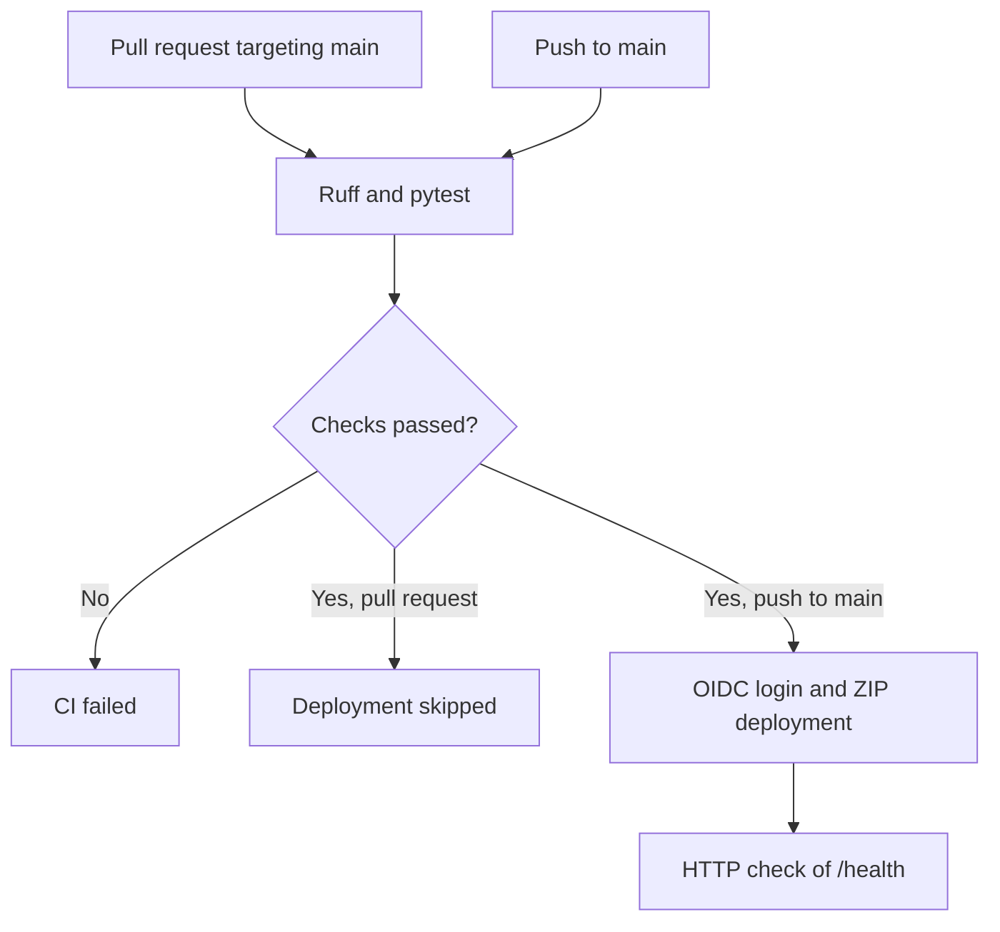

# CloudDesk - Continuous Integration and Deployment

CloudDesk uses a GitHub Actions pipeline to check the code and automatically deploy the API to Azure App Service after an update to `main`. This guide describes the configuration implemented and the results confirmed during the session. The `.github/workflows/ci.yml` file remains the source of truth for the settings executed by the workflow and any subsequent changes.

## Validated results

| Check | Confirmed result |
| --- | --- |
| Local Ruff and pytest checks | Passed |
| Deliberately incorrect test exercise | CI failed, then passed after the correction |
| Pull request adding deployment | `Check Python code` passed; `Deploy to Azure` was skipped |
| After merging into `main` | Both jobs passed |
| Remote HTTP check | `/health` responded and displayed the expected JSON |

Observed response:

```json
{"status":"ok","application":"clouddesk"}
```

These checks were completed during the session. They do not provide continuous availability monitoring.

## 1. Pipeline flow

The workflow is named **CloudDesk CI** and is defined in `.github/workflows/ci.yml`.

| Event | Job `lint` — Check Python code | Job `deploy` — Deploy to Azure |
| --- | --- | --- |
| Pull request targeting `main` | Runs | `Skipped` |
| Push to `main`, including after a merge | Runs | Runs if `lint` succeeds |
| Push to another branch without a PR | Not triggered by the current configuration | Not triggered |



Two mechanisms work together:

- The ruleset for `main` requires the CI check before a merge.
- `needs: lint` makes the deployment job depend on the successful check job in the same workflow run.

The deployment job condition requires both the `push` event and the `refs/heads/main` reference. A `Skipped` deployment job on a PR is therefore expected.

No path filters have been added: documentation changes also trigger CI, followed by deployment after merging into `main`.

## 2. Checks before deployment

The `lint` job keeps the display name **Check Python code**, even though it also runs the tests.

| Check | Command | Purpose |
| --- | --- | --- |
| Dependency installation | `uv sync --locked` | Installs the resolved dependencies; fails if the lockfile needs updating |
| Code analysis | `uv run --locked ruff check .` | Detects issues covered by the enabled Ruff rules |
| API testing | `uv run --locked python -m pytest` | Runs the repository's tests |

CI uses Python **3.13**. The lockfile fixes the resolved dependency versions; it does not, by itself, pin the Python patch version, runner image, or every tool.

The test in `tests/test_health.py` calls the application using `TestClient` and checks:

- HTTP status `200`;
- an exact JSON match with `{"status": "ok", "application": "clouddesk"}`.

This test runs within the test process. It does not contact Azure or validate the hosting configuration.

## 3. Protecting main

The **Protect main** ruleset was configured to control changes.

| Setting | Value |
| --- | --- |
| Enforcement status | `Active` |
| Target branches | `main` |
| Bypass list | Empty |
| Require a pull request before merging | Enabled |
| Required approvals | `0`, appropriate for this individual project |
| Require status checks to pass before merging | Enabled |
| Required check | `Check Python code` |
| Require branches to be up to date before merging | Enabled |
| Restrict deletions | Enabled |
| Block force pushes | Enabled |

The **Required** label was confirmed on the check in the PR.

The day-to-day process is to create a branch, open a PR, obtain a successful required check, and then merge. The check to select in the ruleset is the **job name**, `Check Python code`.

Ruleset settings are stored in GitHub; the YAML file alone cannot recreate this protection in another repository.

## 4. Connecting GitHub to Azure with OIDC

### Identity and trust

A **User-assigned managed identity** represents the pipeline in Azure.

| Component | Configuration |
| --- | --- |
| Identity | `id-github-clouddesk-dev` |
| Resource group | `rg-clouddesk-dev` |
| Region selected at creation | `France Central` |
| Federated credential | `github-clouddesk-main` |
| GitHub owner | `dev-ugo` |
| Repository | `clouddesk` |
| Entity type | `Branch` |
| Branch | `main` |
| Issuer | `https://token.actions.githubusercontent.com` |
| Audience | `api://AzureADTokenExchange` |

The trust relationship is configured on the Azure identity under **Settings → Federated credentials → Add credential → GitHub Actions deploying Azure resources**.

The form also asks for the numeric owner and repository identifiers:

| Azure field | Value from the GitHub API |
| --- | --- |
| Organization ID | `owner.id` |
| Repository ID | Top-level `id` in the response |

These values are available in the [repository API response](https://api.github.com/repos/dev-ugo/clouddesk). For this personal repository, the owner is the `dev-ugo` account.

New GitHub repositories created after 15 July 2026 use an OIDC subject that includes these identifiers by default. The configured format is:

```text
repo:dev-ugo@OWNER_ID/clouddesk@REPOSITORY_ID:ref:refs/heads/main
```

`OWNER_ID` and `REPOSITORY_ID` are descriptive placeholders to replace with the actual numbers. The subject must exactly match the token issued by GitHub.

### Token exchange

The job requests an OIDC token from GitHub. Microsoft Entra ID checks it against the configured trust relationship and then issues an Azure access token. The permissions available through that identity are determined by its RBAC role assignments.

The trust relationship covers the repository and branch. It is not restricted to a particular workflow filename. In our YAML, the `id-token: write` permission is granted to the `deploy` job.

### Repository variables

Three repository variables were added under **GitHub → Settings → Secrets and variables → Actions → Variables**:

| Variable | Value |
| --- | --- |
| `AZURE_CLIENT_ID` | Client ID of the managed identity |
| `AZURE_TENANT_ID` | Tenant ID of the associated Microsoft Entra directory |
| `AZURE_SUBSCRIPTION_ID` | Azure subscription ID |

The workflow reads them through the `vars` context. The GitHub identifiers in the subject and these Azure identifiers serve different purposes.

These values are configuration identifiers. No Azure password, client secret, or publish profile was added for this OIDC connection.

## 5. Azure permissions and RBAC scope

The role assignment was created under:

**App Services → app-clouddesk-dev → Access control (IAM) → Add role assignment**

| RBAC component | Value |
| --- | --- |
| Identity | `id-github-clouddesk-dev` |
| Role | `Website Contributor` |
| Scope | The `app-clouddesk-dev` application — `This resource` |

Under **Members**, the selected type is **Managed identity**, followed by **User-assigned managed identity**.

The role permits deployment and application management, including configuration operations. Assigning it at application scope avoids granting the role across the entire resource group or subscription.

OIDC trust determines who can use the identity. RBAC determines which operations the identity can perform and on which resources. Both configurations are required.

## 6. Deployment to App Service

The `deploy` job runs on `ubuntu-24.04`, with a maximum job duration of **20 minutes**.

| Declared step | Purpose |
| --- | --- |
| Retrieve repository | Check out the commit associated with the run |
| Create deployment archive | Prepare the ZIP file to upload |
| Sign in to Azure with OIDC | Authenticate using the configured identity |
| Deploy to App Service | Upload and deploy the ZIP using Azure CLI |
| Check HTTP health | Call the application's actual domain followed by `/health` |

### Archive and Python build

The ZIP is created in `RUNNER_TEMP`, the runner's temporary directory. It contains only:

- `main.py`;
- `pyproject.toml`;
- `uv.lock`;
- `README.md`.

The project retains `[tool.uv]` with `package = false`. App Service already has `SCM_DO_BUILD_DURING_DEPLOYMENT=true` configured and uses the project files to prepare dependencies through its build engine.

The existing startup command is:

```text
python -m uvicorn main:app --host 0.0.0.0 --port 8000
```

The warm-up settings remain `WEBSITE_WARMUP_PATH=/health` and `WEBSITE_WARMUP_STATUSES=200`. The [deployment guide](deploiement.md) describes the application configuration in more detail.

### Options and concurrency

| Parameter | Value and effect |
| --- | --- |
| Target | `rg-clouddesk-dev` / `app-clouddesk-dev` |
| Deployment type | `zip` |
| `--timeout 600000` | Deployment operation timeout: 600,000 milliseconds, or 10 minutes |
| `--track-status false` | Disables application startup tracking by Azure CLI |
| Concurrency group | `clouddesk-dev-deployment` |
| `cancel-in-progress: false` | Keeps the currently running deployment |

Concurrency limits this group to one running job at a time. It does not guarantee that every pending version will be deployed: GitHub can replace a pending run with a newer one. This setting applies to jobs using the group, not deployments started separately from a terminal.

### Remote verification

The workflow retrieves `defaultHostName` using Azure CLI and then calls its HTTPS URL with `/health`. This avoids assuming the exact domain assigned by Azure.

The check uses `curl --fail`, with up to **12 retries**, a **10-second** retry interval, a **10-second** connection timeout, and a maximum duration of **20 seconds per attempt**.

The step fails if a transport error persists or the server returns an HTTP error, including 4xx/5xx responses. It displays the response body but **does not automatically validate the JSON content or require a status of exactly 200**. Those assertions are part of the local pytest test.

### Automatic steps after the check

`Check HTTP health` is the last step declared in our `steps` list. The interface may still show steps such as **Post Sign in to Azure with OIDC**, **Post Retrieve repository**, and **Complete job**.

Azure Login performs cleanup after the job by default. It clears the runner's Azure login context; the application continues running in App Service.

## 7. Troubleshooting and lessons learned

| Observation | Established interpretation or result |
| --- | --- |
| Test deliberately changed from `200` to `201` | Pytest failed with `assert 200 == 201`; CI detected the mismatch |
| `Process completed with exit code 1` | Indicates a failed command; its logs are needed to identify the cause |
| Logs not visible in the interface | Downloading them made it possible to find the failed assertion |
| Node.js 20 warning and Ubuntu notice | Separate messages from the assertion that caused the observed failure |
| Deprecation warning involving `TestClient` / `httpx` | Present in the initial tests; no library migration was performed during this session |
| Runs stuck in `Queued` for an extended period, with cancellation rejected | An observed blockage with no confirmed root cause |
| Closing and reopening the PR | Created a new run, which also waited; this workaround did not immediately resolve the issue |
| CI eventually completed | Recovery was observed without a code change intended to fix the queue |
| Deployment job `Skipped` on a PR | Expected behavior of the deployment condition |
| `Post…` steps after `Check HTTP health` | Automatic action cleanup |

For the queueing issue, [actions/runner issue #3872](https://github.com/actions/runner/issues/3872) describes similar symptoms. That similarity does not establish that CloudDesk experienced the same root cause.

When investigating a new failure, first identify the affected job and step:

- **Check Python code**: dependency installation, Ruff findings, or pytest assertions.
- **Sign in to Azure with OIDC**: identity variables and an exact subject match with the configured trust relationship.
- **Deploy to App Service**: role, scope, archive contents, and Python build logs.
- **Check HTTP health**: HTTP response, startup, and App Service logs.

The [monitoring guide](supervision.md) complements this process with Metrics, Log stream, and Activity log.

## 8. Scope of this milestone

The automated pipeline deploys to the existing development environment. The application code remains the initial API implementation.

The current validation does not prove that the responding instance is running the exact expected commit SHA. The remote check also does not measure availability over time or verify external dependencies.

The archive contains a fixed list of four files. Adding application modules or assets in the future will require reviewing this list.

The workflow, test, and lockfile are version-controlled. Azure trust, the RBAC assignment, GitHub variables, and the ruleset were configured through the portals; they are not yet recreated through infrastructure as code.

No separate staging deployment, automatic rollback mechanism, or zero-downtime deployment strategy has been added.

## Official references

- [GitHub — Rulesets](https://docs.github.com/en/repositories/configuring-branches-and-merges-in-your-repository/managing-rulesets/available-rules-for-rulesets)
- [GitHub — OIDC reference and immutable subjects](https://docs.github.com/en/actions/reference/security/oidc)
- [Microsoft — Immutable GitHub subjects](https://learn.microsoft.com/en-us/entra/workload-id/workload-identities-github-immutable-subjects)
- [Microsoft — Federation for a managed identity](https://learn.microsoft.com/en-us/entra/workload-id/workload-identity-federation-create-trust-user-assigned-managed-identity)
- [GitHub — Configuration variables](https://docs.github.com/en/actions/how-tos/write-workflows/choose-what-workflows-do/use-variables)
- [Microsoft — Deploying App Service with GitHub Actions](https://learn.microsoft.com/en-us/azure/app-service/deploy-github-actions)
- [Microsoft — Building Python applications in App Service](https://learn.microsoft.com/en-us/azure/app-service/configure-language-python)
- [Microsoft — Azure CLI webapp reference](https://learn.microsoft.com/en-us/cli/azure/webapp)
- [Azure Login — Post-job cleanup](https://github.com/Azure/login#enabledisable-the-cleanup-steps)
- [GitHub — Workflow and job concurrency](https://docs.github.com/en/actions/how-tos/write-workflows/choose-when-workflows-run/control-workflow-concurrency)
- [curl — Option reference](https://curl.se/docs/manpage.html)