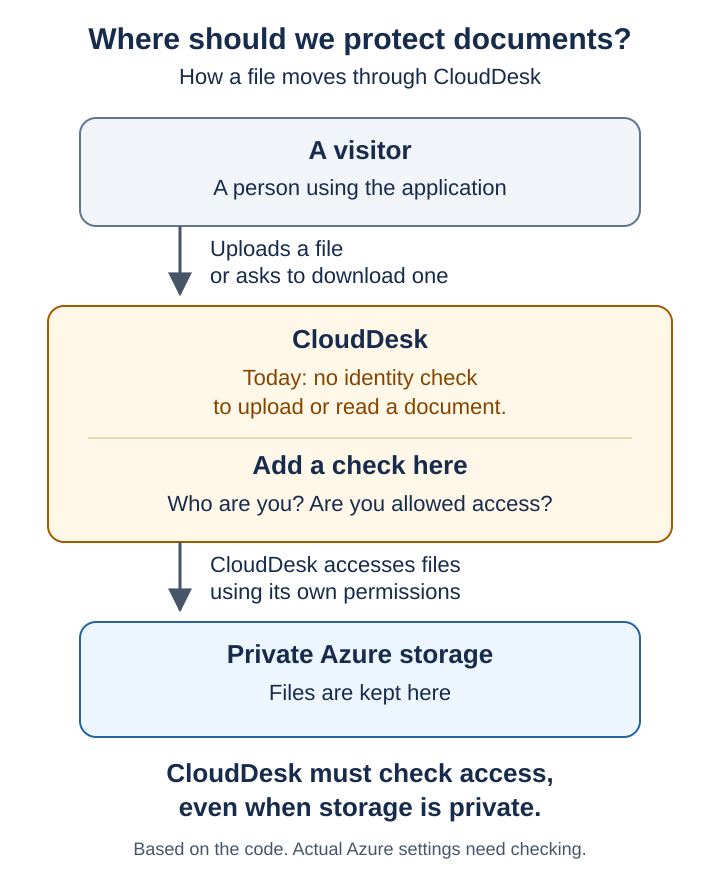

# CloudDesk - Understanding the risks

A **threat model** answers three questions: **what do we want to protect, what could go wrong, and how can we prevent it?**

For CloudDesk, we want to protect documents, IT requests, and the application's availability, while avoiding unexpected costs.

## The three risks to understand first

### 1. Someone reads another person's document

**Example:** Alice accidentally shares a link to her document. Bob uses that link to download it. In the current code, CloudDesk does not ask him to identify himself.

The document's identifier is hard to guess, but it can be shared or leaked.

**What to do:** ask each person to identify themselves, then check whether they are allowed to read that document.

**How to check:** Alice can download her document; Bob cannot, even with the link.

### 2. Someone uploads too many files

**Example:** a person uploads thousands of small files. Each file meets the size limit, but together they use storage space and can increase costs.

In the current code, uploading documents requires no identification, and there is no limit on the number of uploads or the total amount stored.

**What to do:** allow only authorized people to upload files, and limit the number of uploads and the storage space used.

**How to check:** once a person reaches their limit, they cannot add more files.

### 3. An oversized upload slows down the application

**Example:** a person uploads a huge file. CloudDesk rejects it, but receiving it has already used server resources.

The current **5 MiB** limit — roughly 5 megabytes — is checked after the software handling incoming requests has received the file.

**What to do:** stop oversized uploads while they are being received, and limit simultaneous uploads.

**How to check:** an oversized file is stopped before it has been fully received.

## What already protects the application

- Creating an IT request requires a secret key. **This key does not protect documents.**
- The code checks request details and rejects empty files or files larger than 5 MiB before saving them.
- The Azure storage configuration prevents anonymous users from reading files directly.
- Automated checks look for some security issues before deployment.

**The key point: storage is private, but CloudDesk can provide a way to access the files. CloudDesk must therefore check visitors' permissions too.**

## Where to start

1. Protect document uploads and downloads.
2. Limit the amount of data and the upload rate.
3. Check access in Azure and GitHub: who can read the data or change the application?

Then learn how to replace a leaked secret key, spot unusual activity, and restore a deleted file.

Code reviewed on November 17, 2026. The actual Azure and GitHub settings have not been checked: additional protection in front of the application could reduce these risks. This document proposes improvements; they have not yet been applied.

For the evidence, see [document handling](../main.py), [document tests](../tests/test_documents.py), and [key verification](../clouddesk/security.py).

[Back to README](../README.md)
